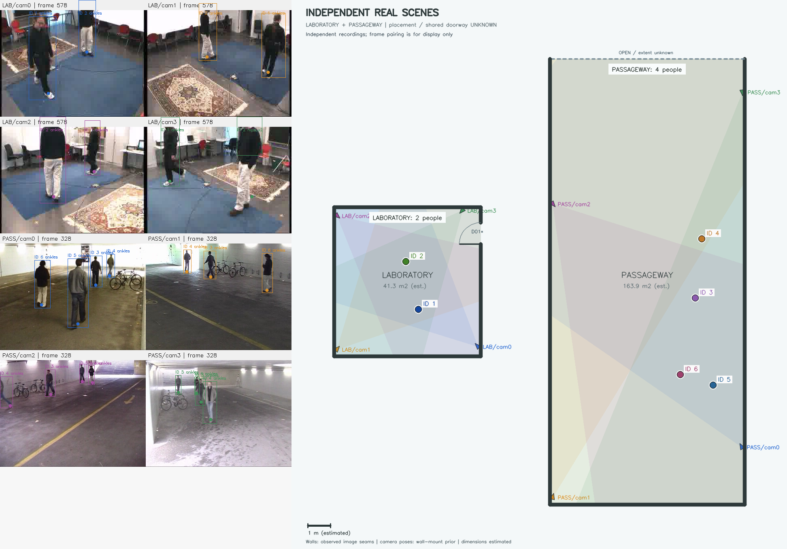
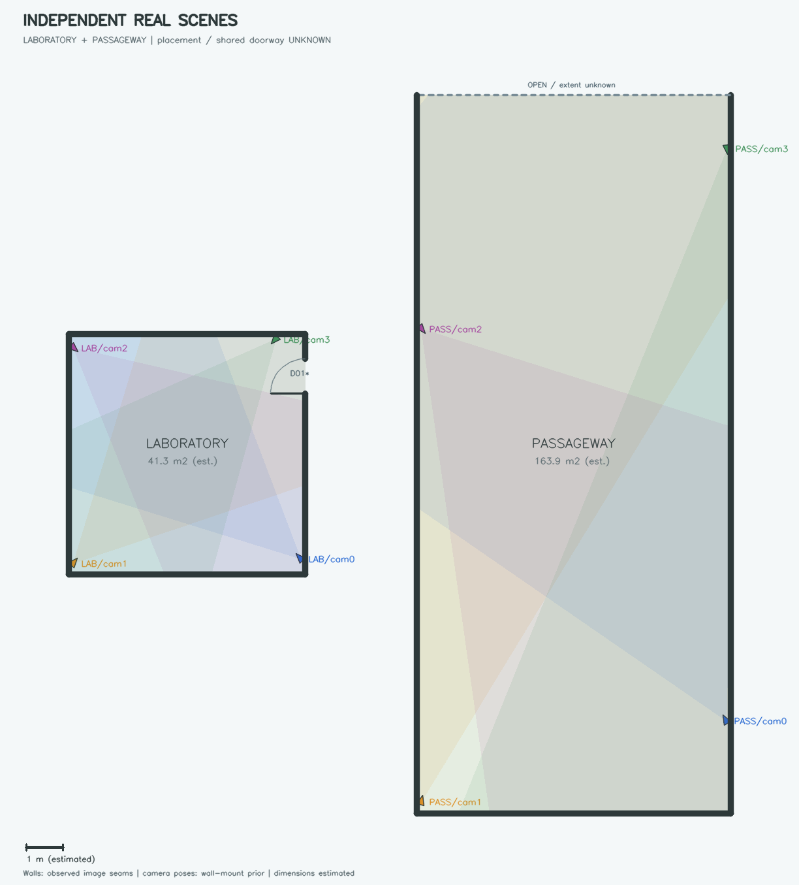
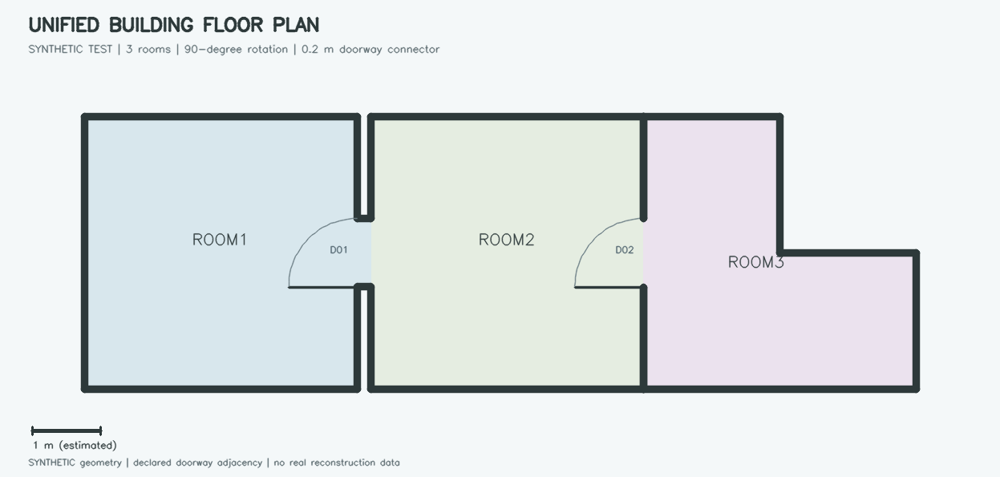
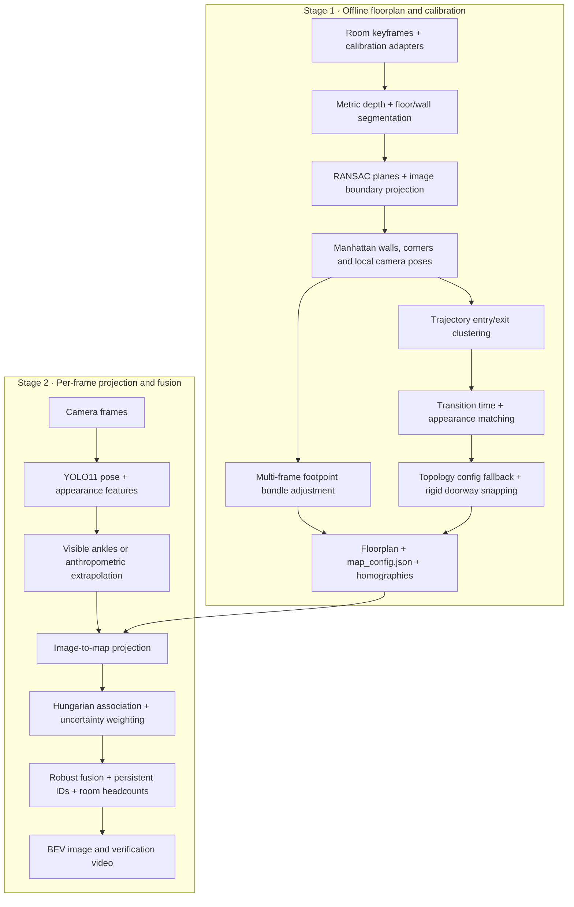

# Multi-Camera 2D Floorplan Tracker

**Turn overlapping camera views into an architectural floorplan with one fused location per person.**


## Visual showcase



*Eight real EPFL camera views → two room maps → one bold marker per fused identity. Laboratory frame 578 shows 2 people; Passageway frame 328 shows 4. These reference counts validate the result; they are not inputs to inference.*



*Straight wall boundaries, estimated camera positions, wall-reaching FOV cones and a trajectory-supported doorway candidate. Laboratory and Passageway are independent recordings: the canvas is an unregistered display atlas, not a recovered physical connection between them.*



*Synthetic regression example: three rooms connected through declared doorways, including a 90° rotation and a 0.2 m connector. This is a topology demonstration, separate from the real EPFL scenes above. Reproduce with `python scripts/render_topology_example.py`.*

A working research prototype with synthetic multi-room topology tests and real-data verification on **2 scenes / 8 cameras / 100 verification frames per camera**. It combines metric depth and image floor–wall seams with published EPFL ground-plane calibration, pose estimation, joint homography refinement and person fusion. It does not yet provide calibration-free reconstruction of arbitrary rooms or a production live-stream service.

## System architecture



The second stage currently runs over recorded clips. Its structure supports per-frame processing; real-time throughput is not claimed.

## Core technical highlights

- **Manhattan room layout extraction.** Metric Depth Anything V2 and SegFormer B2 identify structural support. RANSAC ground/wall planes and image floor–wall seam pixels feed orthogonal boundary fitting. Room boundaries do not come from padded person trajectories. The vectorizer also supports rectilinear polygons; the supplied scene reconstructions are rectangular visible domains.
- **Anthropometric occlusion compensation.** Use ankle midpoint at 1.0× when visible, with a small foot-contact offset; fall back to head-to-knee 1.6×, head-to-hip 2.0×, head-to-elbow 3.0× or head-to-shoulder 5.0× visible height. Torso/head-to-joint scaling estimates missing lower-body length. Extrapolated points receive lower confidence and do not calibrate homographies.
- **Cross-camera footpoint bundle adjustment.** Hungarian associations combine spatial proximity, appearance and ordering. Joint nonlinear optimization refines an eight-parameter projective correction for each camera using reliable multi-frame ankles, room boundaries and geometry priors. Interleaved validation frames, including displayed index 78, are excluded from fitting.
- **Distance and grazing-angle weighted fusion.** Weights begin with ankle confidence divided by squared 3D camera distance. Projection-Jacobian conditioning and truncation/confidence penalties reduce unstable far-view contributions. Every accepted pair in a fused group must lie within 0.35 m; at most one observation per camera can contribute.
- **One identity, one marker.** Persistent IDs and room headcounts replace raw camera-dot counts. Confirmed tracks may coast through at most 5 frames of occlusion; predicted records are flagged and rendered with an asterisk. Optional faint points/tethers expose the underlying observations.
- **Two-tier room topology.** Shared-clock trajectory exits/entries are matched by appearance and travel-time windows. Declarative `configs/topology.json` links supply missing adjacency. Orthogonal rigid transforms align doorways and walls; disconnected components fall back to an atlas. [Import and topology guide](docs/multi_room.md).

## Quickstart

### 1. Install

Tested on **Python 3.10**, macOS ARM, using CPU pose inference (structural backends select MPS when available). Linux/CUDA can be selected through `--device`; that configuration has not been benchmarked here. Install system **Git, curl and FFmpeg**, then:

```bash
git clone https://github.com/khangkaka066/multicam-2d-floorplan-tracker.git
cd multicam-2d-floorplan-tracker
python3.10 -m venv .venv
source .venv/bin/activate
python -m pip install -r requirements.txt
```

`requirements.txt` pins direct runtime dependencies. It is not an operating-system-specific transitive lockfile. Models and videos are downloaded separately and are never committed.

### 2. Prepare the sample data and models

Run these commands **sequentially from the repository root**. The downloaders extract the first 100 frames per camera and later synchronized verification intervals. Laboratory also downloads sparse timeline clips for entry/exit analysis.

```bash
python scripts/download_sample_data.py
python scripts/download_additional_scenes.py
python scripts/download_person_models.py
python scripts/download_structural_models.py
python scripts/download_passageway_verification.py
```

Structural model downloads total several hundred MB. Data utilities request bounded video prefixes or short clips rather than whole recordings. Network access is required for preparation; the prepared pipeline runs locally. Re-running `download_additional_scenes.py` resets Passageway's verification selection, so run its verification downloader again afterward.

### 3. Run end to end

```bash
python main.py
```

The default `all` mode discovers every room manifest under `data/`, reconstructs/calibrates each room, acquires poses, refines homographies, analyzes entry/exit zones, and assembles the result to `outputs/`. Ground rectification runs inside the core build step. `--layout stitched` first uses observed transitions, then `configs/topology.json`; independent recordings without links fall back to an atlas.

Or run individual stages for one scene:

```bash
python main.py --mode build-map --data-dir data --room laboratory --output-dir outputs/laboratory
python main.py --mode calibrate --data-dir data/passageway --output-dir outputs/passageway
python main.py --mode project --data-dir data --room laboratory --output-dir outputs/laboratory
python main.py --mode project --data-dir data/passageway --output-dir outputs/passageway
python main.py --mode build-global
```

`build-map` and `calibrate` share structural reconstruction/calibration and now include entry analysis plus multi-room assembly. New datasets use manifests with camera/image/video paths and image-to-ground calibration. See [multi-room imports, timing and declared doorways](docs/multi_room.md). `build-global` assembles existing local projections without rerunning models.

| Option | Meaning |
|---|---|
| `--frames 100` | Number of verification frames (bounded by available camera frames) |
| `--room office` | Select one discovered room |
| `--layout stitched` | Infer/configure doorway links, with atlas fallback |
| `--layout atlas` | Force a display atlas |
| `--topology configs/topology.json` | Explicit adjacency and transition thresholds |
| `--device cpu` | Pose device; CPU is the validated default |
| `--imgsz 1280` | Override the high-resolution pose pass |
| `--show-raw` | Add faint local raw points and fusion tethers |
| `--mode stitch --building tests/fixtures/building.json` | Exercise explicit doorway-constrained stitching on a **synthetic test fixture** |

Laboratory uses a deduplicated 384 + 960 pose ensemble to retain large cropped people; Passageway uses 1280 for far pedestrians. Both use `conf=0.25`. Acquisition caches include inference settings and source offsets. Delete scene `pose_observations*.json` files to force fresh detection.

### 4. Verify

```bash
python -m unittest discover -s tests -v
python scripts/validate_outputs.py
# Optional diagnostic rendering; does not overwrite the normal showcase:
python scripts/render_fusion_debug.py
```

Unit tests run without model downloads. Two calibration integration tests require EPFL data and are explicitly skipped when it is absent. The artifact validator requires the complete 100-frame, two-scene run; it checks projection identities, camera extrinsics, orthogonal walls, fused centroids, selected reference counts and video decoding.

## Repository structure

```text
assets/                       Final tracked showcase images and small JSON snapshots
docs/
  2dmap.md                    Original architecture and mathematical design reference
  validation.md               Implementation details and validation limits
  multi_room.md               Dataset manifests, clocks and two-tier topology
configs/                      Default and example doorway adjacency JSON
  THIRD_PARTY.md              Dataset/model sources and attribution
scripts/                      Dataset/model setup, doorway analysis and validation
src/
  dataset_loader.py           Manifest adapter and synchronized frame loading
  map_builder.py              Architectural room construction and rendering
  calibrator.py               Ground-plane calibration and consistency reports
  person_locator.py           Pose detection and occlusion compensation
  bev_visualizer.py           Fused BEV and camera-panel/video rendering
  structure.py, semantics.py  Metric depth, segmentation and structural planes
  boundaries.py              Image seam extraction and Manhattan boundary fitting
  architecture.py            Wall/corner representation and rigid room stitching
  bundle_adjustment.py       Joint projective camera refinement
  fusion.py, appearance.py   Association, weighting, tracking and crop features
  observations.py            Cacheable pose acquisition
  projection_pipeline.py     Refinement/fusion orchestration
  scene_atlas.py             Topology-aware building/atlas composition
  topology.py                Doorway detection and cross-room transitions
  geometry.py                Projection and JSON utilities
tests/                        Geometry, architecture and fusion regressions
outputs/                      Ignored runtime outputs; generated by main.py
data/, models/, .venv/        Local only; ignored by Git
main.py                       Unified CLI; defaults to the full sample workflow
requirements.txt              Pinned direct dependencies
```

`docs/2dmap.md` describes the broader target architecture, including research alternatives. The README and implementation notes describe the route actually implemented.

## Output schema

The checked-in `assets/` files are display snapshots. Runtime commands read/write `outputs/`, with scene-local files under `outputs/laboratory/` and `outputs/passageway/`.

| File | Contents |
|---|---|
| `global_2d_map.png` | Base architectural map, camera icons and FOV cones |
| `verification_bev.png` | Camera frames beside fused IDs and room headcounts |
| `verification_projection.mp4` | Full verification sequence, 100 frames at source 25 fps; not an inference-speed benchmark |
| `map_config.json` | Schema version, units, room polygons, corners, walls/openings, doorway evidence, map-to-canvas transform and registration status |
| `transforms.json` | Structural image/map homographies and estimated camera intrinsics/extrinsics, keyed by camera ID |
| `transforms_refined.json` | Footpoint-refined matrices, inverse/canvas mappings, original matrices and bundle corrections |
| `projections.json` | Per-frame raw detections, measured pixels, accepted/rejected projections, fused people, IDs, states and headcounts |
| `verification_metrics.json` | Counts and per-scene detection/fusion statistics |
| `artifact_validation.json` | Geometry, matrix, fusion and saved-media consistency checks |

Matrix directions are explicit; normalize the third coordinate after multiplication:

```text
[X, Y, 1]ᵀ  ∝ H_image_to_map  @ [u, v, 1]ᵀ
[u, v, 1]ᵀ  ∝ H_map_to_image @ [X, Y, 1]ᵀ
p_canvas    ∝ T_map_to_canvas @ p_map
C_world     = -R_world_to_cameraᵀ @ t_world_to_camera
```

Use **`transforms_refined.json` for person projection** and retain the original file for structural camera-pose diagnostics. Metric dimensions/intrinsics are estimates. Atlas scene translations are presentation transforms; `physical_building_registration` is `false` for the supplied scenes. Global display IDs do not imply identity tracking between the independent recordings.

## Results and limits

The published snapshot has 2 observed multi-camera fusions in Laboratory and 4 in Passageway; none of its markers is predicted. Its maximum accepted group diameter is **0.344 m**. This measures internal cross-camera agreement, **not surveyed absolute position accuracy**. Some raw observations exceed 0.35 m and are rejected from fusion; full-clip counts can vary with occlusion. ResNet18 supplies pretrained image features, not a dedicated trained ReID model.

See [implementation and validation details](docs/validation.md) and the [saved validation report](assets/artifact_validation.json).

## Attribution and licensing

The repository's existing [MIT license](LICENSE) applies to its original project code. Dataset imagery, pretrained weights and downloaded third-party code retain their respective terms; see [third-party sources](docs/THIRD_PARTY.md). Raw data, models, environments and runtime caches are excluded from Git. EPFL sample imagery is shown for research demonstration; no separate license to that imagery is granted here.
