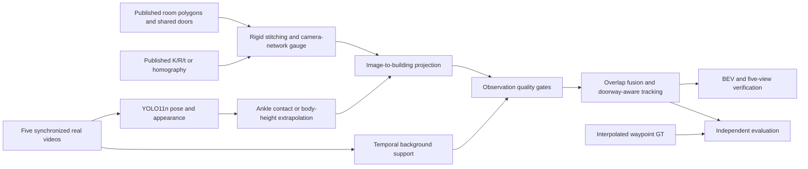

# Multi-Camera 2D Floorplan Tracker

Project real people from five synchronized cameras onto one connected, four-space building floorplan.

The primary multi-room benchmark is **CITIC-MTMC capture1**: Entrance Hall (`HallWide`, `HallSeg`), Passageway PF (`PF`), Passageway PC (`PC`), and Showroom (`Showroom`). These recordings contain real pedestrian transitions within one building. [Official dataset](https://github.com/GTEC-UDC/citic-mtmc-dataset) · [Video archive](https://doi.org/10.5281/zenodo.17511785).


*All five camera triangles sit on inferred wall/end-cap mounts. Their FOV fills and outlines stay inside their assigned rooms, and exterior camera labels avoid pedestrian IDs and door labels. The camera-rendering correction preserves the calibrated poses, homographies and pedestrian projections.*

The floorplan and calibration come from the dataset's published `room_map.json` and `Node*.json`. The pipeline imports each space into a local frame, rigidly stitches shared doorway centers, checks that all rooms agree on the same building coordinates, and centers the frame on the camera network. This benchmark validates connected-room projection and tracking using supplied geometry. Image-only reconstruction remains a separate research capability of the EPFL adapter.

## Reproduce the CITIC result

Tested locally on Python 3.10, macOS ARM, CPU. Git and curl are required. Models, videos and generated caches stay outside Git.

```bash
python3.10 -m venv .venv
source .venv/bin/activate
python -m pip install -r requirements-dev.txt
python scripts/download_person_models.py
python scripts/download_structural_models.py --semantics-only
python scripts/download_citic_mtmc.py
python main.py --data-dir data/citic_mtmc --frames 360 --sample-stride 12 --imgsz 960
python -m pytest -q
python scripts/validate_outputs.py
```

The downloader resolves Zenodo concept record `17511785` to version record `17512043`, reads the ZIP central directory, and downloads only capture1's five video members (about 245 MB compressed). Each extracted video is checked against its ZIP CRC32 and uncompressed size. It records the archive URL, repository commit, source resolutions, FPS, frame counts, and licensing in `data/citic_mtmc/manifest.json`. The whole-archive MD5 is recorded as provenance; member-only downloads are verified by their individual CRCs.

All five recordings run at 25 FPS. Four have 4,318 frames; PC has 4,319. `--sample-stride 12 --frames 360` covers source frames 0–4308 (172.32 seconds) in all cameras. This yields 1,800 synchronized camera samples at approximately 2.08 samples/second. The MP4 plays at that sampled rate to preserve elapsed time. This is a recorded-data benchmark; live inference throughput is not claimed.

When CITIC is prepared, `python main.py` selects it by default and uses 360 samples. Individual stages are also available:

```bash
python main.py --data-dir data/citic_mtmc --mode build-map
python main.py --data-dir data/citic_mtmc --mode calibrate
python main.py --data-dir data/citic_mtmc --mode project --frames 360 --sample-stride 12
```

`build-map` and `calibrate` generate the building geometry and published camera transforms. `project` reads those files, runs cached pose acquisition, overlap calibration refinement, building tracking, evaluation and visualization. `--output-dir` selects a different runtime folder; final CITIC showcase images and metrics are also copied into `assets/`. A short geometry/pose smoke run can use `--frames 10 --sample-stride 400`; its 16-second gaps are unsuitable for tracking-quality measurements.

## Geometry and shared doorways

| Space | Camera(s) | Published components | Connections |
|---|---|---|---|
| Entrance Hall | HallWide, HallSeg | HA + HA2 + HA3 | D03 → PC |
| Passageway PC | PC | PC | D01 → PF; D02 → Showroom; D03 → Hall |
| Passageway PF | PF | PF | D01 → PC |
| Showroom | Showroom | SH | D02 → PC |

`HA3` is a real three-metre vestibule between the main hall and PC. It is preserved as part of the hall polygon rather than collapsing the distance between them. HA2 preserves the hall's northern extension. Other unmonitored spaces in the source plan are omitted. D01–D03 are stable labels assigned here to the three published shared centers; the dataset does not name them or provide opening widths. Drawn widths are a nominal 0.9 m, explicitly marked in metadata.

Canonical building coordinates use metres, X right, Y up, Z up, with the origin at the centroid of the five camera ground positions. `T_source_to_map` converts the dataset coordinates. HallWide, PF and PC provide intrinsic/extrinsic matrices; their ground homographies are derived from those matrices. HallSeg and Showroom supply image-to-ground homographies and positions only; full extrinsics are not invented for them. Declared camera positions are retained separately where published pose matrices imply slightly different centers.

Camera triangles use `render_mount_xy`: the first perimeter wall behind the published pose, with a nearest backward perimeter fallback where a main-room seam is open to an extension. These are inferred display mounts on the simplified plan; original calibrated `camera_center_world`, `camera_xy_estimate`, homographies and the tracking gauge are preserved. The mount estimate is recorded separately with its offset and provenance, rather than being presented as a new surveyed camera center.

FOVs start at these mounts, follow the published angular envelope, stop at the first wall by ray casting, and are clipped to each camera's assigned room in both vector geometry and raster rendering. Hall camera coverage is restricted to the primary HA footprint; HA2/HA3 remain in the building layout as real connectors without implying camera visibility. Camera labels use collision-free exterior callouts that avoid door labels, person IDs and GT markers. The geometric room union remains one connected polygon with no overlapping room interiors, and shared door endpoints coincide numerically.

## Detection, projection and building tracking



- Visible ankles supply the ground point, with a small foot-contact offset. Missing lower bodies use head-to-knee ×1.6, hip ×2, elbow ×3 or shoulder ×5 extrapolation. Large upper-body extrapolations require stronger pose evidence to reject glare hallucinations.
- A temporal median background rejects static pose detections on showroom exhibits. SegFormer B2 labels the background floor; contact points on cabinet/mirror surfaces are rejected, including moving reflections that a motion gate alone cannot distinguish. Extrapolated contacts outside the image remain explicitly unverified by the floor mask. All raw detections and rejection reasons remain in `projections.json`; projection positions are never clamped or snapped into rooms.
- ImageNet ResNet18 crop features support association. It is a generic appearance descriptor, not a dedicated trained person ReID network.
- Overlapping observations fuse using ground-distance, confidence and projection-conditioning weights. A fusion group has at most one observation per camera and a maximum pairwise diameter of 0.65 m. Single-camera observations remain valid in the three singly covered spaces, and unmatched observations from other rooms are preserved.
- Building IDs persist across frames using spatial prediction, appearance, a travel-speed gate, and shortest paths through shared doorway centers. The tracker uses neither GT identities nor a supplied person count. `room_transitions.json` records observed cross-room handoffs.
- A bounded translation correction can align HallSeg with HallWide using reliable simultaneous ankle observations. The first half of the sampled sequence supplies fitting pairs and the second half validates the correction; it is accepted only if held-out overlap agreement improves. No waypoint GT is used to tune it. Other rooms retain their published calibration.

## Results and validation

Measured results are stored in [the showcase metrics](assets/verification_metrics.json) and [the artifact validation report](assets/artifact_validation.json).

| Capture1 measurement | Result |
|---|---:|
| Synchronized samples / camera images | 360 / 1,800 |
| Sequence duration covered | 172.32 s |
| GT positions / predictions | 584 / 552 |
| Matches within 2 m | 477 |
| Mean / median matched error | 0.337 / 0.303 m |
| P95 matched error | 0.875 m |
| Recall / precision within 1 m | 79.5% / 84.1% |
| Localization-gated identity switches | 1 |
| Doorway events matched within 4 s | 11 of 12 GT events; 14 inferred events |
| Doorway-event recall / precision | 91.7% / 78.6% |
| Held-out Hall overlap error before / after refinement | 0.249 / 0.209 m |
| Maximum camera mount distance from room perimeter | < 1e-7 m |
| FOV area outside assigned room, all five cameras | 0 m² |
| Frames checked for collision-free camera labels | 360 |

The verification image shows predicted IDs and black crosses for dataset waypoint GT at one common source timestamp. Its illustration is selected for camera coverage among frames where predictions and GT match within 1 m; all sampled frames, including misses and extra tracks, remain in the reported metrics. Colored ID numbers are tracker outputs; their numbering is independent of GT ID numbering. Doorway events are also compared one-to-one with GT room transitions using a 4-second tolerance; false and delayed handoffs remain visible in the JSON report.

Ground truth is generated by the dataset authors from phone check-ins at floor waypoints, with interpolation between points. It is not a per-frame survey of ankle contacts. The author script also excludes `invitado1` from capture1 GT. The report gives frame-wise Hungarian matches, mean/median/P95 errors within a 2 m match gate, recall and precision at 1 m and 2 m, and identity switches. Recall and precision expose missing and extra tracks alongside the gated error statistic. Capture1 is used for development and verification; these results do not establish generalization to unseen captures. Identity fragmentation and missed detections remain measurable limitations; a clean building map alone does not establish perfect tracking.

The artifact validator independently rechecks source calibration, camera pose/homography identities, common gauge, connected room geometry, shared doorway alignment, unchanged pose-to-map projection, singleton/overlap fusion, GT frame indexing, reported metrics, source-frame decoding, and output video decoding. Its localization gates are mean matched error ≤0.75 m and recall/precision at 1 m ≥70%; these are benchmark acceptance thresholds, not survey-accuracy claims.

The current local run passes **48 pytest tests** and `scripts/validate_outputs.py`. Tests cover retaining disjoint camera observations, overlap deduplication, single-camera tracking and doorway handoffs, the one-based GT convention, rejection of overlap refinements that worsen held-out data, and real CITIC camera/geometry consistency when the dataset is installed. Camera-layout regressions check backward perimeter snapping, rejection of internal component seams as mount walls, first-wall occlusion in concave rooms, vector/raster FOV containment, and label placement clear of walls, doors and people. EPFL tests remain supported.

## Outputs and module boundaries

| File under `outputs/` | Contents |
|---|---|
| `global_2d_map.png`, `global_map.png` | Unified building floorplan and five camera visibility cones |
| `room_<room_id>_map.png` | Intermediate room geometry with its camera(s) |
| `map_config.json` | Room polygons, walls, shared doors, source/canvas transforms and provenance |
| `transforms.json` | Original published-calibration image ↔ canonical-building homographies for all five cameras |
| `transforms_refined.json` | Matrices used for projection, including any accepted overlap correction |
| `projections.json` | Source timestamps, keypoints, contact pixels, raw map positions, quality gates, fusion members and tracker IDs |
| `verification_bev.png` | One synchronized five-view panel with projected IDs and independent GT |
| `verification_projection.mp4` | All sampled BEV frames at the correct elapsed-time playback rate |
| `verification_metrics.json`, `ground_truth_matches.json` | Reproducible waypoint comparison and localization/identity statistics |
| `room_transitions.json` | Inferred handoffs and separate GT room transitions |
| `projection_optimization.json` | Overlap-only fit/validation evidence and acceptance decision |
| `artifact_validation.json` | Geometry, projection, fusion, quality and media checks |

```text
scripts/download_citic_mtmc.py   Resumable member caching, CRC verification and video manifest
src/citic_dataset.py            Dataset adapter, local room geometry and published calibration
src/architecture.py             Shared architectural representation and rigid doorway stitching
src/camera_layout.py            Separate perimeter mounts and wall-occluded FOV geometry
src/person_locator.py           Shared pose plugin and anthropometric extrapolation
src/appearance.py, fusion.py     Shared appearance features and uncertainty-weighted fusion
src/citic_foreground.py         Temporal background, semantic floor and pose-evidence gates
src/building_tracker.py         Observation-preserving association and building-wide IDs
src/citic_optimization.py        Held-out overlap calibration refinement
src/citic_evaluation.py          Evaluation-only waypoint loading and metrics
src/citic_visualizer.py          Building map and synchronized camera panel
src/citic_pipeline.py            Stage orchestration and reproducible artifacts
```

Matrix direction is explicit:

```text
[X, Y, 1]ᵀ ∝ H_image_to_map @ [u, v, 1]ᵀ
[u, v, 1]ᵀ ∝ H_map_to_image @ [X, Y, 1]ᵀ
p_canvas   ∝ T_map_to_canvas @ p_map
```

Use `transforms_refined.json` for the saved person projections. Normalize homogeneous coordinates after multiplication.

## Earlier EPFL and synthetic benchmarks

The existing depth/segmentation structural reconstruction and EPFL calibration adapters remain available. EPFL Laboratory and Passageway are independent recordings, so combining them produces an unregistered display atlas. They cannot validate real cross-room identity transitions. [Earlier implementation details](docs/validation.md) · [Manifest and topology guide](docs/multi_room.md).

```bash
python scripts/download_sample_data.py
python scripts/download_additional_scenes.py
python scripts/download_structural_models.py
python scripts/download_passageway_verification.py
python main.py --data-dir data --room laboratory --output-dir outputs/epfl_laboratory
python main.py --data-dir data/passageway --output-dir outputs/epfl_passageway
python scripts/render_topology_example.py
```

The [synthetic topology fixture](assets/topology_stitching_demo.png) separately tests rotations, doorway constraints and connector gaps; it is not part of the real CITIC evidence. [The original design reference](docs/2dmap.md) describes broader reconstruction research routes.

## Attribution and licensing

Project code: [MIT](LICENSE). CITIC dataset imagery, floorplans and derived showcase images: [CC BY-NC-SA 4.0](https://creativecommons.org/licenses/by-nc-sa/4.0/). Published plan geometry is adapted into canonical coordinates and overlaid with camera/detection annotations. Pretrained models retain their own terms. See [third-party sources](docs/THIRD_PARTY.md).

Please cite Á. Carro-Lagoa, V. Barral, M. González-López, C. J. Escudero and L. Castedo, *Multicamera edge-computing system for persons indoor location and tracking*, Internet of Things 24, 100940 (2023), [doi:10.1016/j.iot.2023.100940](https://doi.org/10.1016/j.iot.2023.100940), and the [CITIC-MTMC dataset](https://doi.org/10.5281/zenodo.17511785).
